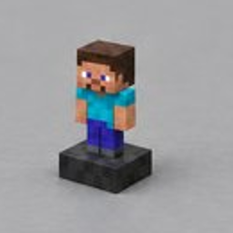
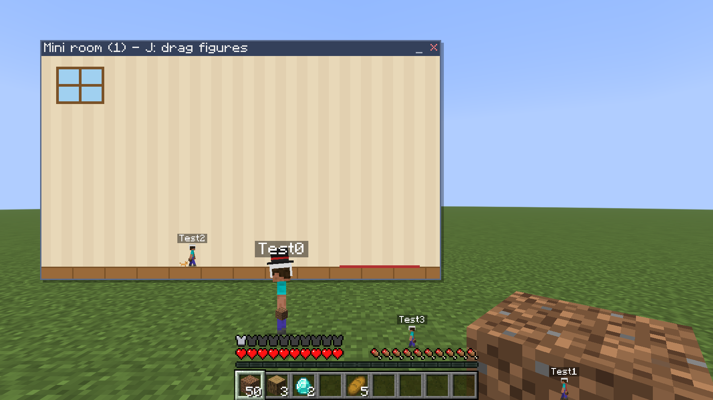
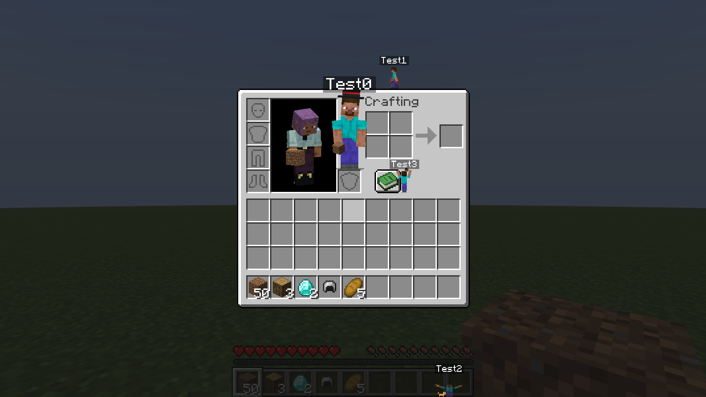
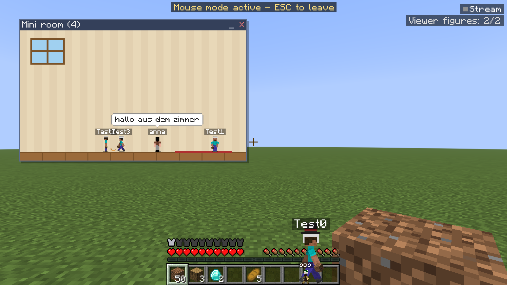
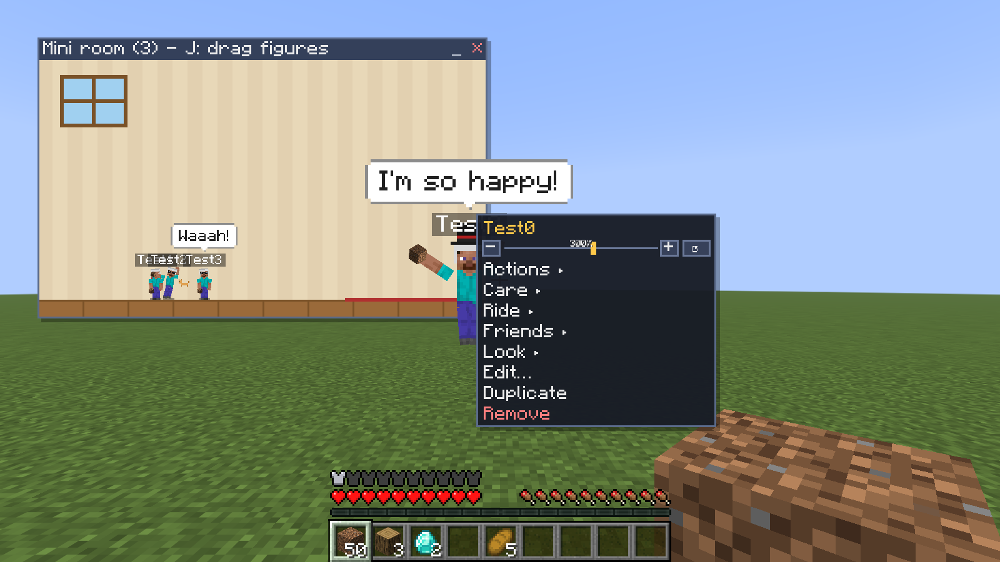

<p align="center">
  
</p>

# Mini-Begleiter (Mini Companions)

    

**Minecraft 1.21.11 · Fabric · Java 21 · nur Client** · von **redstone_nugget**

Kleine Figuren mit echten Minecraft-Skins laufen als 2D-Overlay über deinen Bildschirm: über Hotbar,
Herzen und Hunger, klettern im Inventar über Slot-Reihen, setzen sich auf Chat-Zeilen, stehen auf Knöpfen
von Menüs und leben auf Wunsch in einem frei verschiebbaren Zimmer-Fenster. Optional können Zuschauer
deines Streams (Twitch, YouTube, Kick und TikTok, auch mehrere gleichzeitig) per
`!skin <Minecraft-Benutzername>` im Stream-Chat eigene Figuren erscheinen lassen.

<p align="center">
  
  
</p>
<p align="center">
  
  
</p>

> **English:** Tiny 2D companions with real Minecraft skins walk over your screen: on the hotbar, hearts,
> chat lines, inventory slots and menu buttons, or inside a movable mini room. Optional streamer mode:
> viewers type `!skin <Minecraft username>` in your Twitch, YouTube, Kick or TikTok chat (several at once)
> and get their own figure, their chat messages appear as speech bubbles. Client-side only, Fabric 1.21.11.

> **Nur Client, kein Server nötig.** Die Mod läuft komplett auf deinem Rechner. Sie funktioniert in
> Singleplayer, auf Vanilla-Servern und auf fremden Servern. Sie registriert keine Blöcke, Items oder
> Entities, sendet keine eigenen Netzwerkpakete und verändert die Welt nie.

## Download

Die fertige `.jar` gibt es unter [**Releases**](https://github.com/RedstoneNugget/MiniCompanions/releases).
Oder selbst bauen (siehe [Entwicklung](#entwicklung)).

## Installation

1. [Fabric Loader](https://fabricmc.net/use/) (≥ 0.19) für Minecraft 1.21.11 installieren.
2. [Fabric API](https://modrinth.com/mod/fabric-api) in den `mods`-Ordner legen.
3. `minicompanions-1.0.2.jar` (aus den Releases) in den `mods`-Ordner legen.
4. Optional: [Mod Menu](https://modrinth.com/mod/modmenu) (Einstellungen über das Mod-Menü).

Alle Daten liegen in `config/minicompanions/`:

| Datei/Ordner | Inhalt |
|---|---|
| `config.json` | globale Einstellungen (inkl. Position/Größe des Zimmers) |
| `figures.json` | deine Figuren |
| `streamer.json` | Streamer-Einstellungen |
| `moderation.json` | Sperrlisten (gesperrte Zuschauer, Skins, Wörter, Whitelist) |
| `viewers.json` | gemerkte Zuschauer: wer welchen Minecraft-Namen gewählt hat |
| `skins/` | eigene Skin-PNGs |
| `accessories/` | eigene Accessoire-PNGs |
| `lines/` | eigene Sprüche-Dateien |
| `presets/` | gespeicherte Presets |

Kaputte Dateien werden automatisch als `*.broken-<Zeit>` gesichert, danach wird das letzte Backup
(`*.bak`) oder der Standard geladen. Externe Änderungen an den Dateien werden ohne Neustart übernommen
(Hot-Reload), `/mini reload` lädt alles neu.

## Bedienung

| Taste (frei belegbar) | Funktion |
|---|---|
| **K** | Verwaltung öffnen |
| **J** | Zimmer öffnen und Maus freigeben (Figuren mit gedrückter linker Maustaste hineinziehen). Nochmal J: Zimmer zu, zurück ins Spiel |
| **U** | Maus-Modus: Mauszeiger im Spiel freigeben, um Figuren und Zimmer zu bedienen (ESC beendet) |
| **Rechts-Strg + Entf** | Panik (Streamer): alle Zuschauer-Figuren und Blasen sofort löschen |
| **Ende** | Not-Stopp für Inventar-Aktionen |
| ohne Belegung | Streamer-Modus, Chat-Spawns pausieren, Nachrichten aus, Overlay ein/aus, Riesen-/Mini-Modus, Fotomodus, Zimmer minimieren/zurücksetzen, Ruhemodus |

Alle Tasten lassen sich ändern: **Einstellungen → Allgemein → „Tasten ändern …“** oder in Minecraft unter
**Optionen → Steuerung → Tastenbelegung**, Abschnitt „Mini-Begleiter“.

**Mit der Maus** (in jedem Menü, im Spiel über den Maus-Modus):

- Linksklick auf eine Figur: anstupsen. Doppelklick: kitzeln. Mittlere Maustaste: streicheln.
- Gedrückt halten und ziehen: hochheben und tragen. Loslassen mit Schwung: werfen (mit Abprallen).
- Rechtsklick: Aktionsmenü mit Größen-Regler, Aktionen, Pflege, Reiten (Mauszeiger, Huckepack,
  Mini-Lore), Freunde (befreunden, heiraten, Duell), Aussehen, Inventar-Aufgaben, Bearbeiten.
- **Umschalt + Mausrad** über einer Figur ändert die Größe.
- In Menüs haben Knöpfe und Slots mit Items Vorrang (leere Slots nicht). Mit gedrückter **Alt**-Taste greifst du eine Figur
  auch auf einem Knopf oder vollen Slot.
- PNG-Datei ins Spielfenster ziehen: Liegt die Maus über einer Figur, bekommt sie den Skin, sonst
  entsteht eine neue Figur.

### Das Zimmer

Ein Fenster, das du frei verschieben (Titelleiste ziehen) und in der Größe ändern kannst (an einer der
vier Ecken ziehen). Position, Größe und Zustand werden gespeichert. Das Fenster bleibt immer
vollständig sichtbar und rastet bei geänderter Fenstergröße zurück. Ziehe Figuren hinein; dort laufen
sie auf dem Boden herum. Zieh sie wieder heraus, um sie zurück auf den Bildschirm zu holen. Figuren auf
dem Bildschirm können auf dem Zimmer-Fenster stehen und an ihm hochklettern. Position und Größe kannst
du auch als Zahlen in **Einstellungen → Zimmer** setzen.

### Befehle (reine Client-Befehle)

```
/mini                       Verwaltung öffnen
/mini add <Name|datei.png|https://…|default>
/mini remove <Name>         /mini list         /mini clear
/mini say <Name> <Text>
/mini give <Name> <sort|stack|tidy_chest|equip_armor|food_to_hotbar|craft_planks>
/mini size <Name|all> <Prozent|reset>
/mini preset <Name>         (laden)   ·  /mini preset save|delete|export <Name>  ·  /mini preset import <Code>
/mini play                  Zimmer öffnen + Maus-Modus
/mini room open|close|reset
/mini stream                Streamer-Fenster
/mini streammode <an|aus>
/mini panic                 /mini pause
/mini kick <Zuschauer>      /mini ban <Zuschauer>      /mini unban <Zuschauer>
/mini streamtest <Zuschauer> <Nachricht>   (simuliert eine Stream-Chat-Nachricht)
/mini settings | mouse | photo | rest | stop | reload | debug
```

## Funktionen

- **Beliebig viele Figuren**, optionales Maximum. Leistung: gestaffelte KI, Budget für die Wegsuche,
  Culling, vereinfachte Darstellung ab 300 Figuren, Partikel in festen Arrays.
- **Skins**: Spielername (Mojang, asynchron, 24 h Cache), lokale PNG, Link, Drag & Drop. 64×64 (Steve
  und Alex, automatisch erkannt oder fest einstellbar), 64×32 wird umgewandelt. Antwortet Mojang gerade
  nicht, wird mehrmals neu versucht (auch über eine Ersatz-Adresse); die Figur trägt solange Steve und
  bekommt ihren Skin automatisch, sobald er da ist. Unbekannte Namen ergeben den Standard-Skin und eine
  Chat-Meldung.
- **Darstellung**: Kopf, Körper, Arme und Beine einzeln animiert, Vorder-, Seiten- und Rückansicht aus
  den passenden Skin-Flächen. Pixel bleiben scharf (Nearest-Neighbor, optional ganzzahlige Skalierung).
- **Größe**: global (25–500 %), pro Figur (Vorrang, Regler, Zahlenfeld, Zurücksetzen), eigener Standard
  für Zuschauer-Figuren, Mindest-/Maximalgröße, Umschalt + Mausrad, `/mini size`, zufällige Schwankung,
  Wachsen nach dem Essen und wenn du in Minecraft ein Level aufsteigst, Riesen-/Mini-Modus. Kollisionsbox, Sprunghöhe, Tempo
  (abschaltbar), Hüte, Haustiere, Blasen, Namensschilder und Emotes skalieren mit. Große Figuren meiden
  zu enge Lücken (z. B. zwischen Slot-Reihen).
- **Bewegungswelt**: Boden; HUD (Hotbar, Herzen, Rüstung, Hunger, Luft, XP-Leiste, Bossbars,
  Scoreboard); Container (Fenster, Slot-Reihen, Klettern an den Fensterkanten); Chat (Zeilen bewegen sich
  mit, Eingabefeld, Chat-Box); andere Screens (Knöpfe, Textfelder, Listeneinträge); Zimmer-Fenster.
  Plattformen werden live aus den echten Koordinaten berechnet. Unbekannte Screens fallen auf den Boden
  zurück. Einweg-Plattformen sorgen dafür, dass eine Figur nie eingeklemmt wird. Verschwindet eine
  Plattform, fällt die Figur mit Physik herunter.
- **KI**: Zustandsmaschine (Laufen, Rennen, Springen, Klettern, Sitzen, auf Kanten sitzen,
  Tanzen, Winken, Jubeln, Verstecken …), Plattform-Graph mit Wegsuche, Bedürfnisse (Hunger, Laune),
  7 Persönlichkeiten, Freundschaften, Rivalen und Paare, Kämpfe, Umarmungen, Menschenturm/Räuberleiter.
  Figuren schlafen nicht und springen nur, wenn sie irgendwo hinwollen. Verfehlen sie einen Sprung oder
  ist ein Ziel zu hoch, machen sie einen Super-Sprung (doppelt so hoch). Klappt auch der nicht, suchen sie
  sich ein anderes Ziel. Am Bildschirmrand bleiben sie nicht stehen. Kein Level-System: alle
  Accessoires, Haustiere und Funktionen sind sofort verfügbar. Der Ruhemodus lässt alle Figuren sitzen.
- **Reaktionen** (nur Client-Daten): Schaden, wenig Leben, Tod, dein Minecraft-Levelaufstieg, Regen (Schirme), Gewitter,
  Schnee (Schneebälle), Nacht (Laternen, abschaltbar), Morgen, Wüste, Nether, End, Portale, Höhe, Unterwasser,
  Kampf und Kill-Serien, Bosse, sichtbare Creeper, Spinnen, Phantome, Lava direkt nebenan, Haltbarkeit,
  Hunger, seltene Funde. Dazu Minecraft-Chat-Reaktionen und Sprechblasen.
- **Inventar-Aufgaben** (nur eigene Figuren): sortieren, stapeln, Item in die Hotbar, Kiste aufräumen,
  Rüstung anziehen, Essen in die Hotbar, Bretter herstellen. Es werden nur normale Slot-Klicks verwendet
  (PICKUP/SWAP/QUICK_MOVE, nie Wegwerfen), in einstellbarem menschlichem Tempo. Nach jedem Schritt wird
  geprüft, dass kein Item fehlt und der Cursor leer ist, sonst wird abgebrochen. Auf Multiplayer-Servern
  standardmäßig aus. Not-Stopp-Taste.
- **Ausstattung**: Hüte, Brillen, Umhang, Rucksack, Krone, Schal, Fliege, Kopfhörer, eigene PNGs,
  Rüstung (Einstellungen → Verhalten → „Rüstung der Figuren“: keine, wie der Spieler, Leder, Kette, Eisen,
  Gold, Diamant, Netherit, Kupfer, Schildkröte; pro Figur abweichend per Rechtsklick → Aussehen → Rüstung),
  gehaltenes Item des Spielers (abschaltbar), Haustiere (Katze, Hund, Papagei, Schaf), Farbfilter und
  Regenbogen, Schatten, Partikel, Feuerwerk, Infotafel (Uhrzeit, Koordinaten, FPS, Ping, Haltbarkeit, Biom).
- **Komfort**: Presets (Datei und Teilen-Code), Ruhemodus, Ausblenden-Zonen, Aufnahmemodus (Overlay
  ein/aus, optional aus F2-Screenshots heraushalten), Fotomodus, Sprachdateien (Deutsch, Englisch),
  eigene Sprüche-Dateien pro Persönlichkeit, Debug-Overlay, Mod-Menu-Seite. Keine Tagesaufgaben, Erfolge oder Level.

## Streamer-Modus

Alles, was mit dem Stream-Chat zu tun hat, passiert **nur bei eingeschaltetem Streamer-Modus**
(Standard nach der Installation: AUS).

1. `/mini stream` (oder Verwaltung → „Streamer …“) öffnen.
2. Streamer-Modus einschalten und bei jeder Plattform, auf der du streamst, **deinen dortigen Namen**
   eintragen (die Namen dürfen überall verschieden sein):
   - **Twitch**: Kanalname, z. B. `redstone_nugget`
   - **YouTube**: `@Handle`, Kanal-ID (`UC…`) oder ein Link zum Livestream
   - **Kick**: Kanalname oder Link
   - **TikTok**: Benutzername (mit oder ohne `@`)

   Alle eingetragenen Plattformen verbinden sich **automatisch und gleichzeitig**, ein „Verbinden“-Klick
   ist nicht nötig. Mit dem An/Aus-Knopf neben dem Namen schaltest du eine Plattform vorübergehend ab.
   Bei YouTube und TikTok muss der Stream live sein. Ist er es noch nicht, prüft die Mod jede Minute
   erneut und verbindet sich von selbst, sobald du live gehst.
3. Zuschauer schreiben `!skin <Minecraft-Benutzername>` in den **Stream-Chat** (nicht in den
   Minecraft-Chat), z. B. `!skin jeb_`. Die Mod holt den Skin zu diesem Minecraft-Benutzernamen von
   Mojang. Dann erscheint eine Figur mit diesem Skin und dem Namen des Zuschauers als Namensschild.
   Gleichnamige Zuschauer auf verschiedenen Plattformen sind verschiedene Personen und bekommen eigene
   Figuren. Unter „Optionen“ → „Namen in Plattform-Farbe“ (Standard: „bei mehreren Plattformen“)
   werden die Namen in der Farbe ihrer Plattform gezeigt: Twitch lila, YouTube rot, Kick grün,
   TikTok türkis.
   `/skin …` erzeugt keine Figur und wird auch nicht als Sprechblase gezeigt. Befehlsname und
   Präfix lassen sich im Streamer-Menü unter „Befehl & Limits“ ändern.
4. Weitere Nachrichten dieser Zuschauer erscheinen als Sprechblase über ihrer Figur. Schreibt jemand
   eine neue Nachricht, ersetzt sie sofort die alte Blase (umstellbar unter „Blasen-Warteschlange“).
5. Ist die Figur nicht mehr da – z. B. nach einem Neustart des Spiels oder nachdem der Streamer-Modus
   aus war –, kommt sie mit demselben Skin zurück, sobald der Zuschauer wieder schreibt, und sagt seine
   Nachricht. Abschaltbar unter „Befehl & Limits“ → „Zuschauer merken“.

- **Verbindung**: anonym und rein lesend (es wird nie in den Chat geschrieben), pro Plattform ein eigener
  Hintergrund-Thread,
  automatisches Wiederverbinden mit Backoff, sauberes Trennen. Ereignisse laufen über eine begrenzte,
  thread-sichere Warteschlange zum Client-Thread. Beim Ausschalten wird die Verbindung getrennt, die
  Warteschlange geleert und alle Zuschauer-Figuren und -Blasen werden sofort entfernt.
- **Prüfung**: Minecraft-Namen nur mit 3–16 Zeichen aus `a–z A–Z 0–9 _`. Eingaben werden nie als
  Pfad, Link oder Befehl verwendet; Skins kommen bei Chat-Spawns ausschließlich von Mojang.
- **Limits**: Figuren-Limit (Standard 10, kein Einfluss auf deine eigenen Figuren), „ignorieren“ oder
  „älteste ersetzen“, Cooldown pro Zuschauer, Spawns pro Sekunde, Warteschlange mit Maximum,
  Lebensdauer, eine Figur pro Zuschauer, Rollen-Filter, Whitelist, Freigabe-Warteschlange für Spawns und
  Nachrichten.
- **Nachrichten**: nur reiner Text. Entfernt bzw. ersetzt werden §-Formatcodes, Steuer- und unsichtbare
  Zeichen, Links und E-Mail-Adressen („[Link]“), lange Zeichenketten, Zeichen-Wiederholungen,
  Großbuchstaben-Flut und doppelte Nachrichten (dieselbe Nachricht innerhalb von 30 Sekunden). Dazu kommen ein Wortfilter (zensieren oder verwerfen),
  Rate-Limits sowie einstellbare Anzeigedauer, Länge, Abstand, Deckkraft, Größe, Farbe und
  Rollen-Farben. Nachrichten mit `/` oder `!` am Anfang werden nie gezeigt. Nichts davon wird gespeichert.
- **Moderation**: Panik-Taste, `/mini panic` und roter Knopf im Streamer-Fenster. Rechtsklick auf eine
  Zuschauer-Figur bietet: Löschen, Löschen und sperren, Skin sperren, Nachricht ausblenden,
  Stummschalten. Außerdem `/mini kick` und `/mini ban`, eine Liste aktiver Zuschauer-Figuren mit
  Sofort-Buttons, „Chat-Spawns pausieren“ und „Nachrichten aus“. Bans und Timeouts der Kanal-Moderation
  (Twitch, Kick und YouTube) entfernen Figur und Blasen automatisch. Gesperrte Zuschauer, Skins und
  Wörter bleiben nach einem Neustart gespeichert. Wer gekickt oder gesperrt wird, wird auch nicht mehr
  gemerkt und bekommt erst mit einem neuen `!skin` wieder eine Figur.
- Zuschauer-Figuren können nichts auslösen außer ihrem eigenen Spawn und ihren Blasen. Inventar-Aktionen
  sind für sie grundsätzlich gesperrt.

**Hinweise**

- Beachte die Nutzungsbedingungen deiner Streaming-Plattform. Du bist selbst für die Moderation deines
  Streams verantwortlich. Skins und Nachrichten können anstößig sein, deshalb gibt es Blacklist,
  Wortfilter, Freigabe-Warteschlange und Panik-Taste.
- Verarbeitet werden nur öffentliche Chat-Nachrichten, gespeichert werden sie nie. Dauerhaft gespeichert
  werden nur die Sperrlisten und welcher Zuschauer welchen Minecraft-Namen gewählt hat (`viewers.json`;
  Einträge verfallen nach 60 Tagen ohne Chat-Aktivität, „Gemerkte Zuschauer vergessen“ löscht alle).
  Heruntergeladene Skins liegen nur zwischengespeichert in `cache/skins/` und werden bei jedem Spielstart
  gelöscht.
- **Wie die Plattformen gelesen werden** (alle ohne Login, nur öffentliche Chat-Nachrichten):
  - Twitch: anonymer IRC-Zugang.
  - Kick: öffentliche Kanal-Abfrage und der öffentliche Chat-WebSocket der Kick-Webseite.
  - YouTube: der öffentliche Livechat, so wie ihn der Popout-Chat im Browser lädt.
  - TikTok: TikTok verlangt für Live-Verbindungen eine Signatur. Die liefert der Dienst
    **Euler Stream** (eulerstream.com). Dorthin wird nur die Raum-Nummer deines Live-Streams geschickt.
    Die kostenlose Stufe ohne Konto ist pro IP-Adresse begrenzt. Bei Bedarf trägst du unter
    „Optionen“ einen kostenlosen Euler-Stream-Schlüssel ein.

  Kick, YouTube und TikTok bieten dafür keine offizielle Schnittstelle. Ändern sie ihre Webseiten,
  kann die Anbindung ausfallen, bis die Mod angepasst ist.
- Ein Fenster *innerhalb* des Spiels lässt sich technisch nicht vor einer Bildschirmaufnahme verstecken.
  Nutze dafür den Aufnahmemodus (Overlay-Taste) oder einen Zuschnitt in OBS.

## Take Your Stream Chat

Die Twitch-Anbindung ist nach dem Prinzip der Mod **„Take Your Stream Chat“** von **ijustseen**
entstanden (Stand: `main`, Version 2.1.1, Basisversion Minecraft 1.21.11):
https://github.com/ijustseen/take-your-minestream-template-1.21.7 ·
https://modrinth.com/mod/take-your-stream-chat. Details und Lizenzhinweis stehen in
[THIRD_PARTY_NOTICES.md](THIRD_PARTY_NOTICES.md).

Die Mod bietet keine öffentliche API, deshalb nutzt Mini-Begleiter immer die eigene Anbindung und
funktioniert vollständig ohne sie. Sind beide Mods installiert, stören sie sich nicht: eigene Tasten
(TYSC nutzt `[` und `]`), eigene Config. Beide bauen dann jeweils eine eigene, anonyme Lese-Verbindung
auf; Twitch erlaubt das.

## Entwicklung

Voraussetzung: **JDK 21** (z. B. [Eclipse Temurin 21](https://adoptium.net/)).

```
git clone https://github.com/RedstoneNugget/MiniCompanions.git
cd MiniCompanions
gradlew build              # baut build/libs/minicompanions-1.0.2.jar und führt die Unit-Tests aus
gradlew test               # Tests: Streamer-Pipeline, Chat-Formate aller Plattformen, Filter, Physik, Wegsuche
gradlew runClientGameTest  # startet den echten Client und prüft alles automatisch (Screenshots in build/run/clientGameTest/screenshots)
gradlew runClient -PwithModMenu=true
```

Live-Test gegen echte, gerade laufende Streams (braucht Internet):

```
gradlew test --tests "*LiveChatProbe*" -Dlive=true -Dkick=KANAL -Dyoutube=@KANAL -Dtiktok=NAME
```

Bei jedem Push baut GitHub Actions die Mod und lädt die `.jar` als Artefakt hoch.

Paketstruktur (`de.minicompanions`): `ai` (KI, Persönlichkeit, Sprüche) · `figure` (Figuren, Welt,
Blasen) · `physics` (Plattformen, Physik, Wegsuche, Screen-Plattformen) · `render` (Figuren-,
Blasen-, Pixel-Renderer, Partikel, Aufnahmemodus) · `room` (Zimmer-Fenster) · `gui` (Verwaltung,
Editor, Einstellungen, Streamer-Fenster) · `input` (Tasten, Maus-Routing) · `inventory` (Inventar-
Aufgaben) · `events` (Spielereignisse, Minecraft-Chat) · `streamer` (Streamer-Modus, Chat-Quellen,
Parser, Filter, Moderation) · `skin` · `config` · `commands` · `compat` · `mixin`
(nur Client: Accessoren, HUD-, Maus-, Drag & Drop- und Screenshot-Hooks).

Lizenz: MIT (siehe [LICENSE](LICENSE)).
